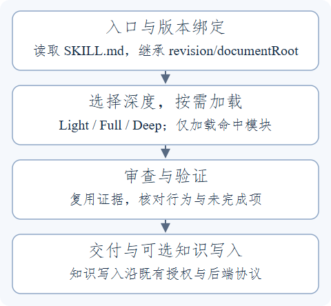

# SelfWorkFlow

SelfWorkFlow 是一套面向 AI 编程 Agent 的中文工程工作流。它帮助 Agent 确定任务范围、按需读取专业方法、保留验证证据，并完成审查与交付。

日常入口是 [`SKILL.md`](SKILL.md)。普通使用只需读取随包文档；CodeGraph、Wiki MCP、安装器和契约 Host 都是按需接入的能力。

[安装与启用](#安装与启用) · [支持的能力](#支持的能力) · [工作方式](#工作方式) · [可选工具部署](#可选工具部署) · [已知问题](#已知问题) · [维护与验证](#维护与验证)

## 安装与启用

### 方式一：clone 后引用入口

适合希望直接使用仓库规则、让后续 `git pull` 更新来源的用户。需要 Git 和能读取本地文件的 Agent 宿主。

```powershell
git -c core.longpaths=true clone https://github.com/InCloudsBelly/SelfWorkFlow.git SelfWorkFlow
cd SelfWorkFlow
git config core.longpaths true
```

在自己的任务项目中让 Agent 读取 clone 的根 `SKILL.md`。可直接在会话中指定，或把以下指令加到宿主支持的项目或个人指令里。

```text
默认工程流程使用 <仓库绝对路径>/SKILL.md。
新任务绑定入口给出的 revision/documentRoot；子任务和续接继承这份绑定。
```

普通使用直接读取随包文档，无需安装运行时、创建 `.venv`、运行生成命令或初始化 submodule。完整方法、引用及静态资源已经包含在 [`skills/selfworkflow/`](skills/selfworkflow/SKILL.md) 中。任务所需的专项按条件加载，普通代码分析可以直接查源码和项目已有导航。

首次使用时，可让 Agent 读取入口并报告 `revision`、`documentRoot`、所选任务深度及需要加载的模块。入口可读而绑定正文不可读时，应报告具体路径与权限问题。

### 方式二：安装自包含 Skill

需要宿主的 Skill 发现入口时，向 Agent 明确提出：

```text
从 <仓库绝对路径> 安装工作流。
```

默认目标是当前用户的 `.agents/skills/selfworkflow/`；Windows 对应 `%USERPROFILE%\.agents\skills\selfworkflow\`。安装对象是完整的 `skills/selfworkflow/`，包括入口、引用、版本和资源。

已有安装时，应保护本地定制和在途任务所绑定的旧版本，更新后回读入口与正文。已有 WheelMaker 等宿主来源联接时，通过宿主更新来源并保留联接。具体路径、备份和并发规则见[接入指南](workflow/onboarding.md)。

### 更新与验收

仓库来源通过 `git pull` 获取新版本；遇到本地修改或分支冲突时先处理实际差异。复制安装的 Skill 需要单独更新，修改仓库不会自动改写已安装副本。

新顶层任务使用更新后的入口；进行中的任务继续使用已绑定的 revision。安装和更新不自动授权 Git push、外部发布或宿主重启。文件安装成功与宿主已经发现、加载该 Skill 是两项验收。

## 支持的能力

下表描述工作流规则和仓库集成提供的能力。需要外部服务、计算环境或宿主 API 的项目，执行前仍须核验实际可用性。

| 能力 | 使用场景与主要结果 | 加载边界 |
| --- | --- | --- |
| 工程实施与诊断 | 沿责任层追踪数据、状态、失效与消费者；约束改动范围，保留失败和边界证据 | 行为代码才加载代码方法；复杂诊断按实际问题启用 |
| 代码审查 | 检查规格、行为风险、兼容性和测试证据；发现问题后继续覆盖剩余范围 | Full/Deep 使用一个独立 Reviewer；修订复核沿原 Reviewer |
| C / C++ 与 UE | 先读取紧凑核心，再选择所有权、类型、并发、ABI、性能、构建或 UE 专项 | 普通文档和非 C++ 任务不加载整套 C++ 方法 |
| CodeGraph 源码关系查询 | 使用项目图核对符号、调用和影响关系，再核对当前源码 | 需要图关系且已选用或已知项目绑定时加载。查询需要 provider 和可用索引 |
| 测试与验证 | 行为变更按 TDD 和最窄充分验证推进，区分静态、构建、运行与复现证据 | TEA、ATDD、NFR、框架和 CI 专项仅在明确请求时启用 |
| Wiki 知识更新 | 区分 read / propose / update，核验来源、正文、图解和实施可用性；经独立审查与后端协议发布 | 需要已验证的 Wiki 服务与权限；普通 Markdown 不自动写 Wiki，可单独借用内容标准 |
| 主题并行 | 同层、页面归属互斥的主题由独立 SubAgent 准备私稿与证据，每个主题覆盖其全部 Page | 不继承主历史；大主题再下钻；共享页和正式队列由主调度管理 |
| 数学与公式 | 数学建模、推导、算法性质分析和 LaTeX 表达；可用 SymPy 做精确复核 | 真实计算需要兼容环境；普通文案不加载数学库 |
| 研究写作 | 组织教程、技术文章和专题说明，核对来源、用途、因果与边界 | 短问答、翻译、内部审查记录和仅格式导出不触发完整写作流程 |
| UI / UX | 为真实界面检索设计资料并检查视觉、布局、交互与可访问性 | UI 线程、GPU 诊断、文档排版不因关键词自动触发 |
| Obsidian | 笔记专属 Markdown、Bases 和 JSON Canvas 文件 | 普通 README、CSV、数据库和泛称流程图不加载这些模块 |
| Skill 与工作流维护 | 调整触发、路由和方法，审查源码与最终文本的字符加载量及紧凑性 | 只有实际维护工作流或 Skill 才命中；复用已有自审 / Reviewer |
| 本地工作产物 | 可选 Runtime 可记录文档代次、审查、验证与知识交接 | 日常任务不强制另建账本；使用前阅读下方已知问题 |

能力入口见 [`skills/`](skills/) 和[模块规则](workflow/modules/)。这些入口复用同一工程流程，不逐个重启设计、确认或审查。

## 工作方式

下图回答新任务如何从一个入口进入必要的方法与检查。箭头表示推进顺序，不表示每个任务都会启用全部能力。



**图 1：入口、按需加载、验证与交付。** Light 以窄自审为主；Full/Deep 按规则安排独立审查。知识写入是请求范围内的可选操作。可编辑[SVG 图源](docs/images/workflow-overview.svg)与正文保留相同的步骤和条件。

### Light、Full 与 Deep

- **Light**：低风险小任务，直接分析或做最小修改，并进行窄自审。
- **Full**：一般工程任务，明确范围和实施方案，完成必要验证及独立审查。
- **Deep**：深分析或高风险任务，增加与实际风险有关的状态、恢复、并发或性能分析。

模式决定任务深度，专业模块决定需要哪些方法。选了 Full/Deep 不会自动开启 TEA、完整 Grilling、所有专业 Skill 或契约 Host。

### 按需加载与上下文控制

入口内联绑定版本的核心规则，子任务和续接沿用这份绑定。同版、同输入、完整正文已经读入时复用，只补缺口；引用一个方法不等于立即展开其整棵引用树。

批量 Wiki 更新按依赖选择主题层级。同层主题互不重叠时可限并发准备，每个主题保持自己的上下文；主调度保留版本、证据引用、状态与缺口。实际 PageJob 与发布仍受后端队列、锁和 CAS 协议约束。

工作流或 Skill 文本变更必须审查字符增量、条件路由、触发 / 排除例和重复加载。使用现有计时、计数观察异常开销；检查点和拆分续接保留未完成范围，不能据此宣称达标或放弃任务。

### 授权、证据与失败处理

同一范围内复用已有授权，不重复确认。超出授权、关键选择或并发冲突才暂停相关动作。来源、静态推断、视觉、构建、测试与设备运行分别留证，未执行的项目如实标记。

模块不可用时，只阻塞依赖它的动作，其余独立工作继续。需要编译时先核对现有环境并保护增量缓存；不为验证便利擅自 Clean/Rebuild、清空缓存或切换全局构建选项。

这些是 Agent 执行规则；操作系统权限、宿主能力与外部服务仍各自负责实际访问和执行控制。普通 Skill 不要求完整契约 Host。显式采用契约模式时，缺少必需能力不能冒充契约验证通过。

## 可选工具部署

只读取 Skill 的用户可以跳过本节。需要 CodeGraph provider、Wiki MCP / Viewer 或旧安装兼容工具时，再部署对应 Runtime。

### Windows Runtime

入口为 [`Install_SelfWorkFlow.bat`](Install_SelfWorkFlow.bat)，实际委托 [`scripts/install-selfworkflow.ps1`](scripts/install-selfworkflow.ps1)。该流程会准备环境、固定来源和安装计划，并写入宿主绑定；它与复制 Skill 文档是不同的安装操作。

先准备 Windows、Git、Python 3.11 或以上及 Node/npm；安装器不会替你安装系统 Python。默认 UE 后端要求 Node 主版本至少 22、不能为 25，并且能加载 `node:sqlite`；具体选择见[CodeGraph 安装说明](extensions/codegraph/README.md#安装选择)。

| Profile | 用途 |
| --- | --- |
| `core` | 基础 Runtime、固定方法来源与 CodeGraph 集成 |
| `knowledge` | 在基础能力之外准备可选 Wiki 集成及其固定依赖 |
| `maintainer` | 面向维护者的完整 Runtime 资源 |

```bat
Install_SelfWorkFlow.bat -Profile core
Install_SelfWorkFlow.bat -Profile knowledge
```

按实际需要选择一个 Profile。固定依赖准备已包含数学方法来源，按 Gitlink 初始化，不追随上游分支。任一步失败时停止后续安装，先处理来源、权限或网络问题。安装器会展示计划并按提示确认，保留事务记录和回滚入口；安装核验会检查清单身份、操作表及实际文件。

Node 版本按对应模块和来源锁核验；Wiki setup 要求 Node.js 22.22.0 或更高，official CodeGraph 的当前锁还限制 Node 主版本小于 25。

需要 DSH 指令根时可显式传 `-DshRoot`。已绑定的 DSH 根、文档根或自定义 provider 的迁移与回滚应沿原安装事务执行，不通过覆盖或删除本地状态完成。

### CodeGraph

默认部署后端由安装器的 `CodeGraphBackend=ue` 选择，来源锁为 [`codegraph-ue.lock.yaml`](dependencies/locks/codegraph-ue.lock.yaml)；显式选择 official 后端时使用[对应锁](dependencies/locks/codegraph.lock.yaml)。安装源和运行绑定需按实际配置核对。

Agent 查询项目唯一的 `.codegraph/`，先核对输入与新鲜度，再做定向查询和源码复核。缺失、不完整、忙碌或需要重建的索引会保留并报告；不会因首次使用而自动初始化，也不靠删缓存或 `--force` 解锁。初始化、重建和候选切换需要明确的恢复方案与授权。

图不可查询时，可以继续直接源码与手工追踪，图证据仍记为未核实。当前访问与失败边界以[CodeGraph 读取规则](workflow/modules/codegraph-read.md)为准。

### SelfOpenWiki

模块位于 [`extensions/knowledge/selfopenwiki/`](extensions/knowledge/selfopenwiki/)。只阅读 Markdown 无需启动服务；需要 Viewer 时，在源仓库执行：

```bat
git submodule update --init --recursive -- extensions/knowledge/selfopenwiki/upstream/openwiki extensions/knowledge/selfopenwiki/visualizer/zxh_wiki_viewer
Manage_SelfWorkFlow_Wiki.bat inspect
Manage_SelfWorkFlow_Wiki.bat setup
Manage_SelfWorkFlow_Wiki.bat visualize --wiki-root "<独立 Wiki Git 仓库的绝对路径>"
```

完整接入需要先按上节部署 `knowledge` Runtime，再完成三步：

1. **构建服务**：执行 `Manage_SelfWorkFlow_Wiki.bat setup --with-mcp`。该 Windows 流程还构建自有 MCP 及目标为 `net9.0 / win-x64` 的 Win32 helper，需要相应 .NET SDK；执行前核对工具链。
2. **绑定本机 Wiki**：确认目录写入授权与备份后执行：

   ```bat
   Manage_SelfWorkFlow_Wiki.bat install --wiki-root "<独立 Wiki Git 仓库的绝对路径>" --confirm-data-safety --confirm-git-authorization
   ```

   此步绑定已有仓库，不把正文复制到工具仓库，也不自动修改 Git refs 或 commit/push。
3. **注册与验收**：先查看计划，再用返回的真实 `planHash` 确认，最后检查服务：

   ```bat
   Manage_SelfWorkFlow_Wiki.bat register
   Manage_SelfWorkFlow_Wiki.bat register --confirm-plan-hash "<返回的 planHash>"
   Manage_SelfWorkFlow_Wiki.bat doctor
   ```

`source-ready` 表示源码构建就绪，`host-registered` 表示宿主配置已注册，`wiki-ready` 才表示真实 status 与安全读取通过。配置已更新但原生工具列表尚未刷新时，需要按宿主机制刷新；不把注册成功当作工具已暴露。某步失败时保留日志与候选，从报告的缺口处理，不跳过前置状态。

Wiki 正文、长期 Claims 和可分享来源位于独立 Git 仓库；运行状态与凭据不混入正文。读取、候选准备、独立审查和正式发布分别判断。完整导入和恢复入口见 [WIKI_LAYOUT 的“拉取后的阅读与导入”](extensions/knowledge/selfopenwiki/WIKI_LAYOUT.md#拉取后的阅读与导入)。

### DocHub

可以请求「把这几篇 Wiki 或 Markdown 导出为 DocHub 发布稿」。[DocHub 发布适配](skills/knowledge-backend/references/dochub-publish.md)负责保留全文、图和公式，转换附件和锚点。正式发布使用宿主提供的 DocHub MCP，按具体稿件确认后提交，并分别验收接口读回与网页呈现。

## 已知问题

[2026-11-02 整体审查与修复](docs/reviews/2026-11-02-overall-workflow-review.md)中的有效问题（1 项 P1、6 项 P2）已修复。原 helper 协议问题为误报：MCP 使用兼容工程输出的 `dist` 产物，另一套 framed helper 输出独立的 bootstrap 目录。

- 清理计划绑定文件身份；旧计划须重新生成。Windows apply 仅支持盘符根，遇到链接、占用或状态变化会拒绝处理。清理批次不是原子事务，运行中失败后须重新生成计划，核对已清理项。
- 旧版曾因严重级别别名误放行的任务不会自动重写历史凭据；应创建新代次，重新执行 Review、post-Review 和验证。
- 仓库修复不自动更新已安装 Runtime 或宿主服务。契约 Host 的实现问题不应外推为普通 Skill 或 CLI provider 都受影响；外部服务仍须用真实就绪证据验收。

## 维护与验证

### 修改哪里

| 路径 | 职责 |
| --- | --- |
| [`SKILL.md`](SKILL.md) | 根入口元信息、绑定及内联规则 |
| [`WORKFLOW.md`](WORKFLOW.md) | 被同步到入口的核心正文 |
| [`workflow/`](workflow/) | 模式、模块及接入规则 |
| [`skills/`](skills/) | 第一方专业方法入口与受控引用 |
| [`skills/selfworkflow/`](skills/selfworkflow/SKILL.md) | 自包含的生成成品，供安装和消费 |
| [`public/`](public/WORKFLOW.md) | 兼容入口与保留的不可变 release |
| [`src/selfworkflow/`](src/selfworkflow/) | 可选 Runtime、契约与安装工具实现 |
| [`dependencies/locks/`](dependencies/locks/) | 固定第三方来源、资源身份与许可记录 |

首次维护使用 Python 3.11 或以上创建环境；已有 `.venv` 时复用：

```powershell
if (-not (Test-Path -LiteralPath '.venv')) { py -3 -m venv .venv }
.venv/Scripts/python.exe -m pip install -e .
```

首次维护还须准备固定方法源码。普通消费不需要这些 submodule，但生成器会核验并复制其选定资源：

```powershell
.venv/Scripts/python.exe -m selfworkflow.v3.submodule_profiles --repository . --profile normal --runtime-profile core
```

该步骤成功后再生成。来源路径缺失、Gitlink / hash 不符或含本地修改时，应先核对锁文件与实际差异，保留已有修改；不直接切到上游最新版本或绕过校验。

上下文方法的维护来源固定在 `dependencies/upstream/context-engineering` submodule；仅研究/升级时按[来源记录](workflow/references/context-efficiency.md)初始化与核对。运行端使用 SelfWorkflow 的[按需压缩与恢复规则](workflow/modules/context.md)，不加载整个上游 Skill 集；普通消费和文档生成不依赖该研究来源已初始化。效果验证按需读取，不增加常驻摘要或评测流程。

规则、方法、来源锁或随包资源变化后，在根目录执行生成与检查：

```powershell
.venv/Scripts/python.exe -m selfworkflow.cli skill sync --repository .
.venv/Scripts/python.exe -m selfworkflow.cli skill check --repository .
```

同步从同一内容快照生成入口和两棵完整 release；检查核对源文、副本、引用与保留版本。源码、根入口、生成副本和完整新 release 一起交付；不手改生成文件或改删旧 revision。常驻入口和本次命中加载链的字符增量、触发与复用规则，也须完成紧凑性审查。

可按改动范围运行现有 Python 检查；完整测试入口为：

```powershell
./scripts/test.ps1
```

该入口执行仓库的 unittest 集合。外部 provider、MCP、设备运行和安装行为仍需要各自的新鲜证据；静态规则检查不等于真实模型触发率或 token 节省实测。命令集合可用 `.venv/Scripts/python.exe -m selfworkflow.cli --help` 查看。

### 来源与阅读路径

工作流规则以任务绑定的 `revision/documentRoot` 为准。原生 Skill 与普通 agent-policy 的使用从本文安装步骤进入；显式契约 Host 的接口、回执和失败边界见[契约接入](workflow/legacy-host.md)。历史验收数据保留在[审查记录](docs/reviews/)与[设计记录](docs/design/)，不作为当前环境已经验证的证明。

README 按 knowledge 的[质量标准](skills/knowledge-backend/references/wiki-quality.md)和[正文契约](skills/knowledge-backend/references/article-contract.md)检查阅读主线、图文、实施信息、来源与维护性；这是仓库文档更新，不启动 Wiki 发布事务。检查证据与目标 GitHub 呈现的未核项记录在[整体审查报告](docs/reviews/2026-11-02-overall-workflow-review.md)。

第三方方法和资源沿固定来源保留其许可及来源记录；不同来源的许可状态不能相互代替。详细身份见各来源锁，公共文档消费无需初始化这些源码 submodule。
