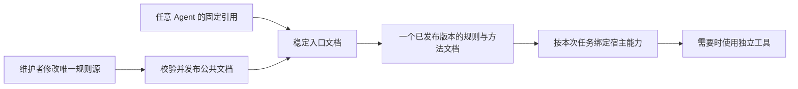

# 以公共文档交付 SelfWorkflow

状态：文档入口、独立发布器与旧安装迁移支持已实现并完成独立审查；个人 Codex 入口已切换。初次迁移时公共版本包含 416 份文档与静态资料，后续接入说明随公共入口更新。依据为 2026-10-20 的当前仓库内容。

## 目标与验收口径

使用者向 Agent 提供一个固定文档入口，Agent 读取入口及本次任务需要的文档即可工作。维护者修改流程、职责或 Skill 路由后，只发布一次公共文档；已有 Agent 的接入引用、配置和本机安装不随之更新。

“即取即用”要求消费者无需安装 SelfWorkflow、运行打包器、初始化上游子模块、配置 Python/Node、注册原生 Skill 或理解 artifact/manifest/CLI。它不保证 Agent 凭文档获得原本没有的读写、测试、独立上下文或服务调用能力。所需能力的缺失只影响依赖它的动作，不能伪造通过。

一次接入成本与每次修改成本分开：首次需让 Agent 能读取指定入口；之后规则更新不再更改该接线。没有外部文档读取能力的宿主，需要复制或上传公共文档，此类宿主不能承诺自动获得后续更新。下文“新任务”指用户发起的顶层任务；子任务、独立 Reviewer、阶段切换和上下文续接不重新选择版本。

当前按本机共享目录作为主要交付方式设计。同一套文件可被静态托管为 URL，或作为离线文档包分发；这些是交付位置的差异，不是不同的工作流实现。单文件导出仅为不能跟随引用的宿主提供，不作为另一份手工维护的规则。

## 当前实现的实际阻碍

| 位置 | 当前耦合 | 必须处理的变化 |
| --- | --- | --- |
| [WORKFLOW.md](../../WORKFLOW.md) | 普通任务先从 bootstrap snapshot 解析 artifact manifest，再寻找规则 | 普通入口直接确定文档版本和引用位置，不要求安装身份 |
| [installer.py](../../src/selfworkflow/installer.py) 的 `_managed_instruction` | 向宿主入口复制整份轻量策略并绑定安装快照 | 普通宿主入口只保留稳定的文档引用；旧内容一次迁移 |
| [adapters.py](../../src/selfworkflow/adapters.py) 的 `build_runtime` / `_copy_matt_skills` | 原生 Skill 和许多参考材料在打包时才复制、变换到实际可读位置 | 维护者发布前完成文档依赖闭合，消费者不再构造这些目录 |
| [CodeGraph 读取模块](../../workflow/modules/codegraph-read.md) | 默认通过本机已安装的 `selfworkflow.cmd` 做 provider 核对 | 通用工作流不负责部署工具；操作细则按实际已提供的能力执行 |
| [UI Skill](../../skills/ui-ux-pro-max/SKILL.md)、[写作 Skill](../../skills/content-research-writer/SKILL.md)、TEA 等 | 引用安装后才有的路径，有些路径还要求 Python、CSV 或校验程序 | 方法文档进入公共文档；可执行检索/校验留在明确的工具集成中 |
| [知识模块](../../workflow/modules/knowledge.md) | 个人默认后端部分依赖 artifact profile | 个人默认选择进入独立的个人偏好文档；用户选择与服务实时状态仍优先 |

上述表格记录改造前的阻碍；本次用发布后的独立文档包解除这些消费约束，不要求普通 Agent 处理源仓库依赖。

## 三个职责明确的模块

### 公共文档模块

它是普通 Agent 唯一需要理解的工作流 Interface：入口、规则、按需方法、能力要求与失败语义。公共依赖只包含可读取的文档、必要静态图像和许可声明。不得要求消费者运行源码、加载 JSON schema、构造 catalog 或访问维护者的子模块工作区。

流程与权限规则保留唯一 owner。路由文档指向具体方法文件，不要求 Agent 先把所有方法安装成原生 Skill。公共方法采用普通文档路径，避免将公共目录本身当成原生 Skill 安装目录。宿主的原生 Skill 发现仅是可选便利机制，不能成为公共文档路由的前提，也不能保存另一份 SelfWorkflow 的方法或触发规则。

### 文档发布模块

只由维护者或现有 CI 使用：从唯一规则源与固定来源导出文档，校验引用闭合，再一次发布。复用现有来源锁与许可校验；不复用含 Host Python、可执行代码和冻结依赖的整个 runtime 作为公共文档包。

规则仍只编辑一份，公共发布目录是派生产物。不能同时手工维护源码规则、公共规则、单文件导出和每家 Agent 的规则副本。出版元数据与来源 hash 可以由发布器生成，消费者不以执行 manifest 验证器作为普通任务的启动条件。

### 工具集成模块

CodeGraph、SelfOpenWiki、UI 检索程序、构建/测试工具及严格 Host 各自拥有运行程序、配置、协议与升级方式。公共文档只声明“需要做什么、调用的语义、必须检查的结果”，并根据当前会话的真实工具协议绑定操作。

现有 `selfworkflow.cmd` 可保留为已有环境的工具桥接入口。它不能再是读取普通规则或调用所有外部工具的统一前置条件。缺少等价的必要操作时，如实阻断对应动作；不能因追求免安装而放宽独立 Review、来源校验、Wiki 发布确认或 CodeGraph freshness 要求。



图中只有公共文档是工作流的消费入口。工具自身的安装与协议升级不经过每家 Agent 的工作流副本。

## 稳定入口与版本一致性

### 建议的对外布局

以下是目标布局示例，不表示这些文件已经交付：

```text
public/
  WORKFLOW.md                    # 固定位置，指向当前发布版本
  releases/<revision>/
    WORKFLOW.md                  # 该版本的实际启动规则
    modes/*.md
    modules/*.md
    methods/INDEX.md             # 意图、排除条件、能力要求、实际文档链接
    methods/<id>/METHOD.md       # 来自 Skill 的可读方法，不注册原生 Skill
    references/...               # 选定的完整方法引用与许可
    integrations/.../*.md        # 外部工具调用和失败语义
```

使用一个公共发布目录，避免每个 Agent 一套 versions、current.json 和安装 manifest。固定入口只是很短的版本选择文档，不再复制流程全文。发布后版本目录不可原地修改，旧版不自动删除，以免破坏正在运行的任务。发布器本身不是消费者依赖，也不引入常驻服务或更新 Agent。

所有实际 Markdown 链接按声明它的文件所在目录解析。若规则使用 `documentRoot` 或 `projectRoot` 这种逻辑位置，须明确给出其来源，不用当前工作目录猜测。工作流文档目录、用户项目目录、Wiki 数据目录及工具源码目录分开，不把项目命令运行到公共文档目录中。

### 宿主永久接线示例

```text
每个用户顶层任务开始前，读取并遵循 D:/SelfWorkFlow/public/WORKFLOW.md。
由入口选择一个文档版本；被委派的子任务继承主任务的版本绑定。
仅加载本任务命中的规则与方法，阶段切换和上下文续接不重新选版。
本入口不保存工作流规则副本。若无法读取，报告具体缺口。
```

这是一次性的指令引用，例子中的路径可替换为经授权可读的固定地址。文件名、目录位置及读取方式是宿主接线的真正差异；工具名通常不值得新增一套厂商工作流。Agent 不能越过权限或更高优先级指令去读取文档，文档也不能赋予新的权限。

### 新任务的加载过程

1. 用户顶层任务实际读取固定入口，取得它指向的完整文档版本；不沿用上个顶层任务的版本选择。收到委派的 Agent 则使用主任务传来的版本绑定，不读取 latest 另选版本。
2. 将该版本的位置记在当前任务上下文，不创建安装记录或运行账本。
3. 读取该版本的启动规则，再按任务加载 mode、当前模块和必要 Skill。路由与被引用材料都来自该版本。
4. 按实际工具、权限和上下文语义检查本轮需要的能力。方法文档可以直接读取，不要求原生 Skill 工具存在。
5. 后续阶段、子任务和独立 Reviewer 继续使用同一文档版本；上下文压缩只补读该版本的缺失内容，不重新选择 latest。交接材料传递顶层任务归属、文档 revision 与可读位置，不传递作者私有推理。缺少绑定、绑定不一致或子 Agent 无法读取该版本时，停止依赖它的动作并向委派者报告；不能自行选择新版冒充同版审查。
6. 完成时如实区分执行结果与缺口。缓存命中、读到文档和安装成功都不等于能力验证通过。

只在新任务选择新版，可同时满足更新传播与任务内一致性。运行中发现旧规则有必须立即修复的问题时，要显式迁移当前任务，重评受影响步骤和授权；不在未知状态下静默混用两版规则。

“及时更新”准确指下一次成功读取固定入口的新任务取得新版本。已经缓存全文的长期会话、离线副本及只导入一次内容的产品，不属于自动刷新保证；需要明确重新读取或重新分发。不能用文档声明假装宿主已有热加载机制。

## 文档怎样做到真正自足

- 发布器遍历声明的路由和引用闭包，产物中必须存在本次分发所承诺的全部规则与方法。不把 `dependencies/upstream`、本机 snapshot、临时目录或消费者磁盘扫描作为缺失依赖的修补方式。
- Matt、Ponytail、TEA、Anthropic 等选定方法在维护者侧导入并固定来源；保留所选内容所需的许可。导出时保留触发边界与 SelfWorkflow 的 owner 规则，不把上游的第二套编排带入普通流程。
- 文本方法及其可读索引能作为文档交付。CSV 索引等用于选择文档的元数据，应在发布端转换成可读索引，不能要求消费者安装解释器完成路由。
- UI 搜索、图索引更新、后端事务、严格 receipt 校验等是实际程序能力。公共包交付其调用文档，不声称 Markdown 可替代程序。工具缺失时使用规则明确允许的替代方法；没有获准的等价方法则保留对应缺口。
- 用户项目规则和个人偏好分别属于项目、个人，不混入公共发布包。需要个人 Wiki 默认后端时，通过可选的个人偏好文档显式选择；没有个人文件时使用公共默认，不因 profile 缺失阻塞启动。
- 发布来源和入口位置必须是用户已信任的来源；链接闭合、revision 或同源 hash 都不能证明来源可信，亦不能把第三方文档升级成用户授权。

## 更新与维护成本

普通规则更新只经过：修改唯一规则源 → 校验文档 → 发布完整版本 → 原子更新固定入口。发布失败保持上一版入口；不能先切换入口再补写文件。宿主不执行发布器，不接收逐家安装任务。

| 变化 | 维护者动作 | 使用者动作 |
| --- | --- | --- |
| 调整阶段、确认、Review 或失败语义 | 修改规则并发布一次文档 | 新任务重新读取相同入口 |
| 调整 Skill 触发或方法 | 更新唯一方法源/路由，发布闭合引用 | 无需复制或注册 Skill |
| 新增普通 Agent | 核对读取方式与本次可用能力，必要时写接入说明 | 首次提供固定引用；规则不按厂商分叉 |
| 新增个人偏好 | 修改个人偏好文档 | 公共入口不变 |
| 规则要求变化但现有工具协议仍满足 | 更新能力要求与操作文档 | 按任务检查现有工具 |
| 工具实现或不兼容协议变化 | 工具 owner 升级程序/连接并更新调用文档 | 只更新实际受影响的工具环境 |
| 入口位置或宿主读取机制变化 | 维护接线兼容或迁移文档 | 仅该接线需要一次调整 |

“只维护对外文档”的保证覆盖工作流规则更新，不覆盖真实程序升级和权限变更。把这些部署藏进 Agent 自动安装步骤，并不会减少成本，只会隐藏副作用。

## 实施顺序与兼容

1. **先提供独立可读的公共文档版本。** 保留现有安装与契约用户；新增普通文档入口、文档路由与所选参考闭包。普通启动不读取 artifact manifest，也不调用 resolver/provider。不要仅增加一个仍跳回安装快照的 README。
2. **一次性迁移已有接线。** 把本工具所有的内嵌策略 managed block 改成固定入口引用，保留用户块、项目规则和其他工具配置。必须退役所有 SelfWorkflow 所有、会被自动发现的冻结 Skill 正文与触发规则副本，不只处理当前已有冲突的文件；此后的触发判断和方法正文都来自任务绑定版本的公共文档。若保留可选原生入口，只允许一个不携带具体方法/触发副本、能遵守任务版本绑定的稳定转发入口，不按 Skill 各建一份转发。用户或项目拥有的其他 Skill 不在该退役范围，冲突仍由其实际 owner 处理；本工作流的文档更新保证不覆盖这些外部规则。不能要求新版文档自行覆盖上级指令。先在隔离根验证，再按已有安装/回滚保护执行；本方案不自动修改当前个人环境。
3. **解除普通文档对工具部署的依赖。** CodeGraph/Wiki 等按实际操作独立检查；保留必要的 fresh、CAS、来源、Review 和确认语义。严格 contract-managed Host 的 package/receipt/runtime 仍独立验证；未满足时不能宣称通过，也不能让它成为普通启动前提。
4. **验证更新传播后再收缩旧默认路径。** 确认文档版本更新无需重写任一宿主入口、原生 Skill 或本机配置。通过真实宿主测试后，才把安装器从推荐使用入口降为工具配置/兼容入口；不按文件数量删掉现有事务与回滚实现。

前三步的生产改动范围包括启动规则、方法路径、文档导出、相关校验与 managed block 迁移。实现已进入仓库；实际验收证据与尚未验证的宿主行为分别记录，不把静态文档检查等同于真实 Agent 执行。

## 需要实际证明的验收

| 场景 | 预期结果 |
| --- | --- |
| 空白消费者目录，没有 `.agents/.codex/.dsh`、Python、Node、SelfWorkflow CLI、原生 Skill 发现 | 能读取入口并完成普通分析/规划任务；不因文档载入启动安装 |
| 消费者没有 Git，也没有任一上游子模块 | 所选公共方法仍能完整读取；不能声称全部方法可用却跳过缺失引用 |
| 维护者修改规则并发布，已有 Agent 接线保持逐字节不变 | 新任务读取新版；不运行 install/build、不改宿主配置 |
| 一个任务开始后发布新版，随后创建独立 Reviewer 或续接上下文 | 主任务、Reviewer 与子任务继续读取绑定的原版；新的用户顶层任务使用新版 |
| 只支持文件读取的未知 Agent | 通过文档索引找到适用方法；不要求先新增 Agent id/YAML 或注册 Skill |
| 发布新版 Skill 的触发条件和方法正文，原生 Skill 目录保持逐字节不变 | 新的顶层任务从公共索引与方法文档取得新版语义，不触发旧副本；主任务及子任务仍按绑定版本执行 |
| CodeGraph、独立上下文或 Wiki 中任一必要能力缺失 | 仅相应动作/认证受阻，报告事实；不伪造证据，不擅自削弱硬门槛 |
| 公共引用断裂、发布只完成一半、入口无法读取 | 发布前拒绝切换入口；消费方报告缺口，不扫描旧安装或混用版本 |
| Wiki 源仓库 dirty 或离线，当前任务不需要 Wiki | 不影响普通文档启动；所需工具操作单独报告其真实状态 |
| 检查旧 managed block 和 SelfWorkflow 所有的自动 Skill 入口 | 不残留版本化规则、方法或触发副本，不能只证明它们今天不冲突；用户/项目所有的外部冲突明确交由 owner |
| 检查公共包和接线的内容/写入记录 | 普通消费只有读取；没有嵌入凭据、私有路径或自动安装/配置脚本 |

发布器静态测试只能证明闭包、格式和更新写入范围；还需在至少两种真实宿主中确认入口读取、阶段间加载和新任务更新。未执行的真实宿主与冷启动验证必须保留 `unverified`。

## 不采用的路径

- 只简化安装命令：仍然要求按宿主更新安装状态，未满足目标。
- 为每家 Agent 生成完整规则：维护源虽集中，消费副本仍会过期，更新仍需传播到每家。
- 把所有方法塞进一个常驻巨型提示词：增加每次上下文负担，并削弱按需加载；只保留可选单文件导出。
- 再建规则读取服务、工具代理、自动安装器或更新 daemon：引入新的运行依赖，第一阶段不需要。
- 去掉能力检查、Review、版本一致性或来源限制来换取“随处能跑”：这只是降低验收要求。

## 首轮实施证据与后续验收

以下保留首轮实施时的结果；后续发布权限修复、最小 Adapter 调整、隔离回归和真实宿主最终结果见 [2026-10-20 接入验收](../reviews/2026-10-20-document-onboarding-validation.md)。

发布接口为 `documents publish/check/snippet`，固定入口为 `public/WORKFLOW.md`。公共版本包含普通规则、按需方法、可读资料索引与许可；工具快照和严格 Host 验证保持独立。发布在维护者独占锁下校验完整版本后切换入口，失败不改上版，旧任务继续读取不可变目录。

`install plan --document-root` 复用原事务、文件所有权/hash、备份与回滚机制，一次退役受管 Skill 副本并改写受管入口。绑定后后续计划自动沿用该入口；不能通过漏字段或修改计划 hash 恢复冻结副本。隔离目录测试覆盖用户内容保护、更新不改宿主入口及回滚。

实际资料闭包、发布并发和迁移的最终 12 项针对性测试全部通过；大回归为 97 项中 95 项通过，2 项在 knowledge 安装子模块准备阶段受已有 Wiki Viewer 修改阻塞，已只读确认 `submodule-dirty`，保留用户内容。独立审查发现的 6 项 Important 均已关闭。

个人迁移事务已应用并核验：233 个受管 Skill 文件退役，Codex 受管块只保留公共入口引用，块外用户规则逐字节保留；现有工具桥接保留，备份和 hash-bound 回滚计划已生成。后续规则更新不需要再次安装。

本轮 CodeGraph 增量同步仍返回 not-fresh，保留旧库且不自动重建，结构图证据为 `unverified`；不能复用原设计阶段的 fresh 结论。跨 Agent 冷启动、模型触发准确率与两种真实宿主执行仍为 `unverified`。
